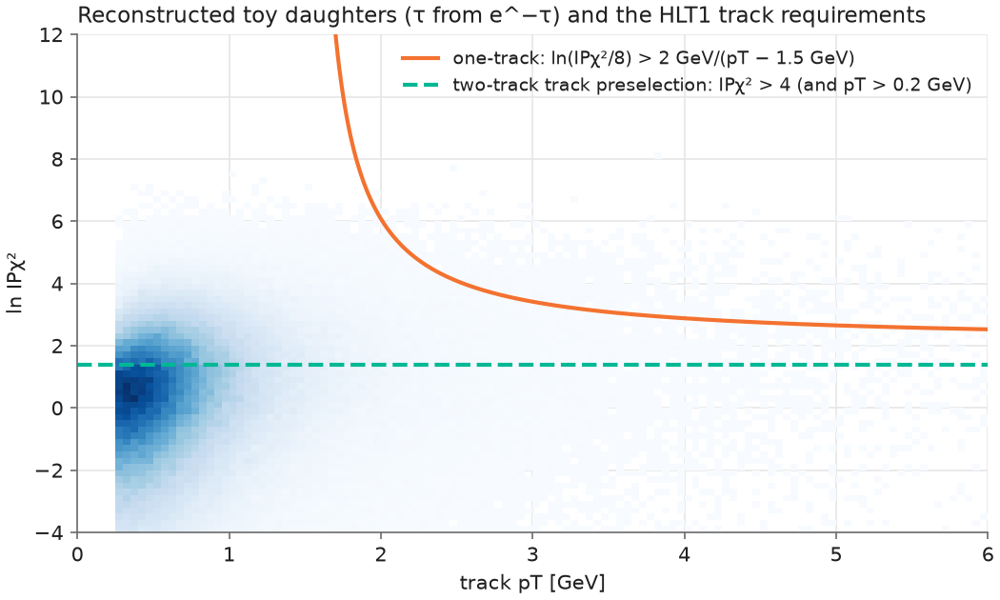

# Phase 5 — Acceptance emulator: diagnostics

**All numbers come from the proposed toy values in `configs/acceptance/base.yaml`,
which are not yet confirmed.** They show how the emulator behaves; they are not a
prediction for Run 3. Reproduce them with
`.venv/bin/python scripts/acceptance_diagnostics.py`: 10⁶ events of flat four-body phase
space with τ uniform in [0, 8), which takes about 15 s.

## The emulator

See `src/d02hhhh_toys/acceptance.py`. Each event is processed in five steps:

1. random orientation of the decay in the D0 rest frame;
2. D0 production (pT spectrum, η, φ) and boost to the laboratory;
3. flight distance L = (p/m)·cτ·τ and impact parameters IP = |L × û|, smeared with
   σ_IP = s·(a + b/pT);
4. track requirements (η, p, pT) and a momentum-dependent tracking efficiency;
5. all four daughters reconstructed; offline, at least N daughters with IPχ² > 4
   (`offline.n_tracks`, **0 by default**); then HLT1.

The emulator never uses the charges, so ε(τ, p̄) = ε(τ, p), and a test checks this
(`test_cp_symmetric`). CP-symmetric mis-modellings should therefore leave Δx and Δy
unbiased; Phase 8 will check that.

### HLT1 lines

The lines follow the ideas of the LHCb HLT1 inclusive hadron lines, with their own
functional forms and toy parameters:

- **`one_track`:** a reconstructed daughter with pT > pT_wall and
  ln(IPχ²/IPχ²_floor) > k/(pT − pT_wall). This is a hyperbola in the (pT, ln IPχ²)
  plane. The required IPχ² diverges at the wall and falls towards the floor at high
  pT, so a soft track must be very displaced and a hard one only slightly. The toy
  values are pT_wall = 1.5 GeV, k = 2 GeV and IPχ²_floor = 8.
- **`two_track`:** any of the six pairs of reconstructed daughters.
  - *Track preselection:* each track has pT > 0.2 GeV and IPχ² > 4.
  - *Vertex preselection:* vertex pT > 1 GeV, corrected mass > 1 GeV, DOCA < 200 µm,
    vertex χ² < 20, and 2 < η < 5 for the flight direction.
  - *Score:* ln FDχ² + 0.5·ΣpT[GeV] + 0.5·ln(min IPχ²) − 0.05·χ²_vtx > 7.
  - *Emulated vertex:* the DOCA is |g|·√(σ_IP,1² + σ_IP,2²) and χ²_vtx = g², with g
    standard normal. FDχ² comes from the flight distance, smeared with
    σ_xy = 20 µm and σ_z = 100 µm projected on the flight direction
    (`vertex_resolution`).
- **`box`:** at least N daughters with pT and IPχ² above fixed cuts. These are the
  earlier rectangular lines, kept as a cross-check.

The lines are combined with `mode: any` (fire if any line fires) or `mode: mixture`
(one line per event, chosen at random with `fractions`).

| File | HLT1 |
|---|---|
| `base.yaml` | one-track or two-track (default) |
| `hlt1_one_track.yaml`, `hlt1_two_track.yaml` | a single line |
| `hlt1_mixture.yaml` | one-track for 50% of events, two-track for the other 50% |
| `hlt1_box_a.yaml`, `hlt1_box_b.yaml` | ≥ 1 track with pT > 1 GeV and IPχ² > 7.4, or ≥ 2 tracks with pT > 0.5 GeV and IPχ² > 4 |

Phase 7 overrides take dotted keys, for example
`config.with_overrides({"ip_resolution.scale": 1.05})`. A list of lines is replaced
as a whole.

The daughters are soft: the median reconstructed pT is about 0.4 GeV. **Only 0.3% of
reconstructed daughters pass the one-track boundary**, so the two-track line does
almost all the work.

## Acceptance versus decay time

| HLT1 | ε over τ ∈ [0, 8) | ε at the plateau (maximum bin) |
|---|---|---|
| one-track or two-track (default) | 10.9% | 13.4% |
| one-track only | 1.5% | 2.6% |
| two-track only | 10.9% | 13.4% |
| 50/50 mixture | 6.2% | 7.9% |
| box, 1 track | 7.8% | 9.7% |
| box, 2 tracks | 10.1% | 12.5% |

- **The two-track line contains the one-track line.** The default and two-track-only
  decisions differ on 7 events in 10⁶: every event that fires the one-track line also
  fires the two-track line. The mixture is therefore close to half of the two-track
  acceptance at every τ.
- **The turn-on is unchanged:** half of the plateau is reached at τ ≈ 1.1, and the
  curve is flat from τ ≈ 3. An offline IPχ² > 4 on all four daughters would move the
  half point to τ ≈ 2.6. On one or two daughters it changes nothing, because the
  two-track line already requires IPχ² > 4 on both tracks of its pair.
- **No fall-off at large τ:** nothing in the emulator removes long-lived decays. In
  LHCb, the D0 IPχ² requirement against secondary charm and the vertex geometry make
  the acceptance fall at large t.
- **The overall level is set by the track requirements.** Only 28% of events have
  all four daughters with pT > 0.25 GeV.

## Correlation between decay time and phase space

The figure shows ε(τ | bin)/ε(τ) in thirds of four variables, for the default HLT1.
- A curve that is flat but different from 1 is a phase-space acceptance that
  factorises from τ.
- **A curve whose level changes with τ is the t × p correlation**, which a factorised
  model ε_PS(p)·ε_t(τ) gets wrong.

Ratio of the lowest to the highest third:

| Variable | τ < 1 | 2 < τ < 6 |
|---|---|---|
| m(K⁺K⁻) | 1.09 | 1.34 |
| m(π⁺π⁻) | 0.99 | 0.91 |
| m(K⁺π⁻) | 0.93 | 0.88 |
| min p* of the daughters (D0 frame) | 0.78 | 0.80 |

- **There is a sizeable phase-space acceptance that factorises.** The clearest case is
  min p*, which is about 0.8 at all τ: a soft daughter is more often lost to the
  pT > 0.25 GeV requirement.
- **The t × p correlation is now mainly in m(K⁺K⁻):** the ratio goes from 1.09
  (τ < 1) to 1.34 (τ > 2). The likely cause is the corrected-mass > 1 GeV and vertex-pT
  requirements of the two-track line. They act on pairs whose kinematics depend on
  where the event sits in phase space, and they matter more once the pairs pass the
  displacement score, that is at larger τ. The other variables change by less than
  10% between the two τ ranges.
- **Correlation, and therefore bias, depends on the trigger emulation.** The earlier
  box cuts gave different patterns: with IPχ² > 4 on all four daughters the ratios
  for τ < 1 were 0.4–1.6. This is a natural axis for the Phase 7 scenarios.

## Using the real LHCb HLT1 code instead

The released Run 3 HLT1 (Allen) is on CVMFS, at
`/cvmfs/lhcb.cern.ch/lib/lhcb/ALLEN/<version>/`, with sources under
`device/selections/lines/inclusive_hadron/` and thresholds under
`configuration/python/AllenConf/thresholds/`. The weights of its two-track network are
in `/cvmfs/lhcb.cern.ch/lib/lhcb/PARAM/ParamFiles/<version>/data/`.

The real one-track boundary and two-track network could be used in place of the lines
above. That would need:
- the vertex quantities the network takes as inputs (FDχ², vertex χ², DOCA,
  corrected mass), at least as well emulated as here;
- the weights read at run time, not copied into this repository;
- a citation of the LHCb trigger software in any result.

The lines here are deliberately our own, so that none of this is required.

## Open items

- **Confirm or tune the toy values.** In particular:
  - the track pT > 0.25 GeV cut and the D0 pT spectrum, which set the overall level;
  - the two-track score and its preselection, which set the turn-on and the t × p
    correlation;
  - the vertex resolution.
- **Choose the default HLT1 configuration for Phase 7.** The default is now
  one-track or two-track.
- **Decide whether to model the high-τ fall-off,** for example with a D0 IPχ²
  requirement or a maximum flight distance.
