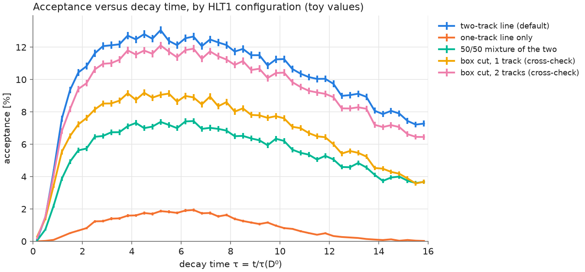
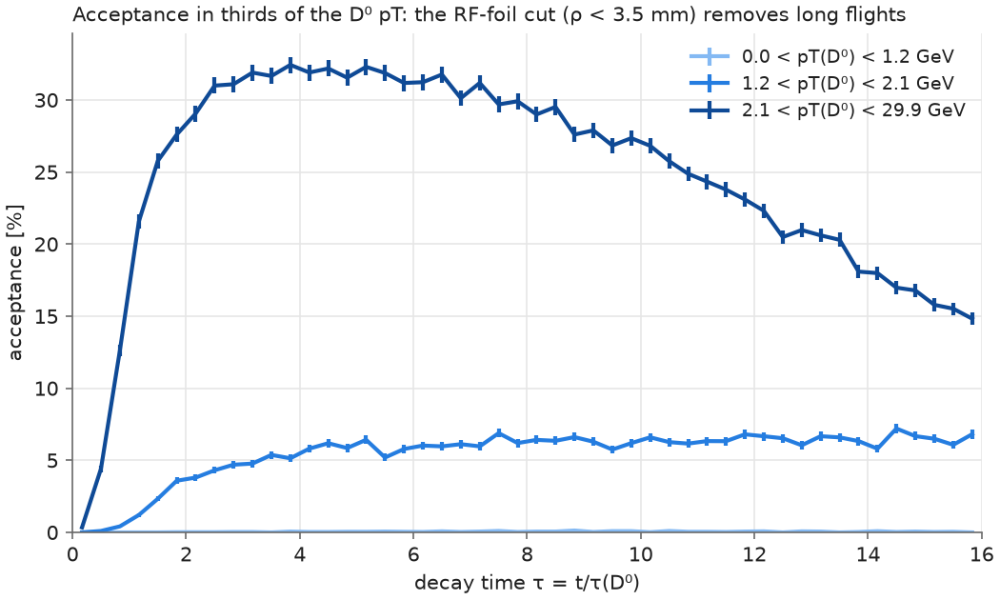
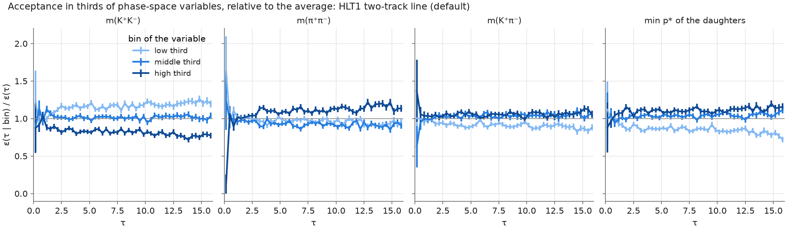

# Phase 5 — Acceptance emulator: diagnostics

**All numbers come from the proposed toy values in `configs/acceptance/base.yaml`,
which are not yet confirmed.** They show how the emulator behaves; they are not a
prediction for Run 3. Reproduce them with
`.venv/bin/python scripts/acceptance_diagnostics.py`: 10⁶ events of flat four-body phase
space with τ uniform in [0, 16), which takes about 15 s.

## The emulator

See `src/d02hhhh_toys/acceptance.py`. Each event is processed in five steps:

1. random orientation of the decay in the D0 rest frame;
2. D0 production (pT spectrum, η, φ) and boost to the laboratory;
3. flight distance L = (p/m)·cτ·τ and impact parameters IP = |L × û|, smeared with
   σ_IP = s·(a + b/pT);
4. track requirements (η, p, pT) and a momentum-dependent tracking efficiency;
5. the selection:
   - all four daughters reconstructed;
   - offline, at least N daughters with IPχ² > 4 (`offline.n_tracks`, **0 by
     default**);
   - **the decay vertex inside the VELO RF foil**: radial distance from the beam line
     ρ = √(L_x² + L_y²) < 3.5 mm (`decay_vertex.rho_max_um`; `null` turns it off);
   - HLT1.

The emulator never uses the charges, so ε(τ, p̄) = ε(τ, p), and a test checks this
(`test_cp_symmetric`). CP-symmetric mis-modellings should therefore leave Δx and Δy
unbiased; Phase 8 will check that.

### HLT1 lines

The lines follow the ideas of the LHCb HLT1 inclusive hadron lines, with their own
functional forms and toy parameters. **The default is the two-track line alone.**

- **`two_track`:** any of the six pairs of reconstructed daughters.
  - *Track preselection:* each track has pT > 0.2 GeV and IPχ² > 4.
  - *Vertex preselection:* vertex pT > 1 GeV, corrected mass > 1 GeV, DOCA < 200 µm,
    vertex χ² < 20, and 2 < η < 5 for the flight direction.
  - *Score:* ln FDχ² + 0.5·ΣpT[GeV] + 0.5·ln(min IPχ²) − 0.05·χ²_vtx > 7.
  - *Emulated vertex:* the DOCA is |g|·√(σ_IP,1² + σ_IP,2²) and χ²_vtx = g², with g
    standard normal. FDχ² comes from the flight distance, smeared with
    σ_xy = 20 µm and σ_z = 100 µm projected on the flight direction
    (`vertex_resolution`).
- **`one_track`:** a reconstructed daughter with pT > pT_wall and
  ln(IPχ²/IPχ²_floor) > k/(pT − pT_wall), with pT_wall = 1.5 GeV, k = 2 GeV and
  IPχ²_floor = 8. This is a hyperbola in the (pT, ln IPχ²) plane. The required IPχ²
  diverges at the wall and falls towards the floor at high pT.
- **`box`:** at least N daughters with pT and IPχ² above fixed cuts (a cross-check).

The lines are combined with `mode: any` (fire if any line fires) or `mode: mixture`
(one line per event, chosen at random with `fractions`).

| File | HLT1 |
|---|---|
| `base.yaml` = `hlt1_two_track.yaml` | two-track (default) |
| `hlt1_one_or_two_track.yaml` | one-track or two-track |
| `hlt1_one_track.yaml` | one-track only |
| `hlt1_mixture.yaml` | one-track for 50% of events, two-track for the other 50% |
| `hlt1_box_a.yaml`, `hlt1_box_b.yaml` | ≥ 1 track with pT > 1 GeV and IPχ² > 7.4, or ≥ 2 tracks with pT > 0.5 GeV and IPχ² > 4 |

Phase 7 overrides take dotted keys, for example
`config.with_overrides({"ip_resolution.scale": 1.05})`. A list of lines is replaced
as a whole.

**The daughters are soft** (median reconstructed pT about 0.4 GeV): only 0.3% of them
pass the one-track boundary. Adding the one-track line to the two-track line changes
the decision of 3 events in 10⁶.

## Acceptance versus decay time

| HLT1 | ε over τ ∈ [0, 16) | maximum (at τ) |
|---|---|---|
| two-track (default) | 10.1% | 13.0% (5.2) |
| one-track only | 0.9% | 1.9% (6.5) |
| 50/50 mixture | 5.5% | 7.4% (6.5) |
| box, 1 track | 6.8% | 9.2% (4.5) |
| box, 2 tracks | 9.3% | 12.1% (5.2) |

- **Turn-on:** half of the maximum is reached at τ ≈ 1.2. An offline IPχ² > 4 on all
  four daughters would move it to τ ≈ 2.8. On one or two daughters it changes nothing,
  because the two-track line already requires IPχ² > 4 on both tracks of its pair.
- **Fall-off:** the RF-foil cut removes decays with ρ > 3.5 mm. The default acceptance
  falls from 13.0% at its maximum (τ ≈ 5) to 7.3% at τ ≈ 16.
- **The overall level is set by the track requirements.** Only 28% of events have
  all four daughters with pT > 0.25 GeV.

## Why the D0 pT spectrum matters

The production spectrum is the one input that sets the laboratory boost, and the boost
controls three things.

1. **The overall level.** The daughters' laboratory p and pT scale with the D0
   momentum, and so does their chance of passing the p > 2 GeV, pT > 0.25 GeV and
   tracking-efficiency requirements.
2. **The turn-on.** At fixed τ, the flight distance L = (p/m)·cτ·τ, and hence the
   daughters' IP and the vertex FDχ², grow with the D0 momentum. A soft D0 must live
   longer to pass the displacement requirements.
3. **The fall-off.** The radial distance ρ = (pT/m)·cτ·τ reaches 3.5 mm at
   τ ≈ 53/pT[GeV]. A hard D0 is removed at much smaller τ.

| pT(D0) third | median pT | ε at τ ≈ 4 | ε at τ ≈ 12 | ρ = 3.5 mm at τ ≈ |
|---|---|---|---|---|
| 0–1.2 GeV | 0.77 GeV | 0.03% | 0.07% | 69 |
| 1.2–2.1 GeV | 1.61 GeV | 5.8% | 6.7% | 33 |
| 2.1–30 GeV | 3.01 GeV | 31.9% | 22.3% | 18 |

With the proposed spectrum, dN/dpT ∝ pT/(1 + (pT/2.5 GeV)²)³ on [0, 30] GeV, the
selected sample is almost entirely D0 with pT > 1.2 GeV. Its turn-on and fall-off are
those of this hard tail. A different spectrum, for example the measured prompt-D0
spectrum or one from Run 3 simulation, changes:
- the shape of ε_t(τ);
- the size of the t × phase-space correlation, because the same boost enters the
  daughters' pT and IP.

## Correlation between decay time and phase space

The figure shows ε(τ | bin)/ε(τ) in thirds of four variables, for the default HLT1.
- A curve that is flat but different from 1 is a phase-space acceptance that
  factorises from τ.
- **A curve whose level changes with τ is the t × p correlation**, which a factorised
  model ε_PS(p)·ε_t(τ) gets wrong.

Ratio of the lowest to the highest third, from counts pooled in each τ range:

| Variable | τ < 1 | 2 < τ < 6 | 10 < τ < 16 |
|---|---|---|---|
| m(K⁺K⁻) | 0.99 | 1.38 | 1.54 |
| m(π⁺π⁻) | 1.19 | 0.90 | 0.82 |
| m(K⁺π⁻) | 0.94 | 0.87 | 0.83 |
| min p* of the daughters (D0 frame) | 0.99 | 0.80 | 0.72 |

- **The correlation grows with τ** in every variable, and most in m(K⁺K⁻), where the
  ratio goes from 0.99 to 1.38 to 1.54.
  - At small τ the displacement requirements dominate, and they depend only weakly on
    where the event sits in phase space.
  - At larger τ, the two-track vertex requirements (corrected mass and vertex pT) and
    the RF-foil cut, through the D0 pT, select different regions of phase space.
- **Correlation, and therefore bias, depends on the trigger emulation.** With the
  earlier box cuts and IPχ² > 4 on all four daughters, the τ < 1 ratios were 0.4–1.6.
  This is a natural axis for the Phase 7 scenarios.

## Using the real LHCb HLT1 code instead

The released Run 3 HLT1 (Allen) is on CVMFS, at
`/cvmfs/lhcb.cern.ch/lib/lhcb/ALLEN/<version>/`, with sources under
`device/selections/lines/inclusive_hadron/` and thresholds under
`configuration/python/AllenConf/thresholds/`. The weights of its two-track network are
in `/cvmfs/lhcb.cern.ch/lib/lhcb/PARAM/ParamFiles/<version>/data/`.

The real one-track boundary and two-track network could be used in place of the lines
above. That would need:
- the vertex quantities the network takes as inputs (FDχ², vertex χ², DOCA,
  corrected mass), at least as well emulated as here;
- the weights read at run time, not copied into this repository;
- a citation of the LHCb trigger software in any result.

The lines here are deliberately our own, so that none of this is required.

## Open items

- **The D0 production spectrum and η range** (see above): keep the toy form, or use a
  measured or simulated spectrum.
- **The other toy values:**
  - the track pT > 0.25 GeV and p > 2 GeV cuts;
  - the two-track score and its preselection;
  - the vertex resolution.
